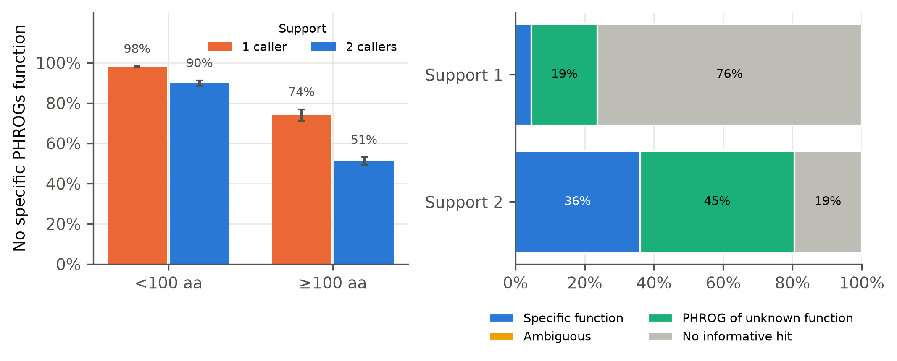
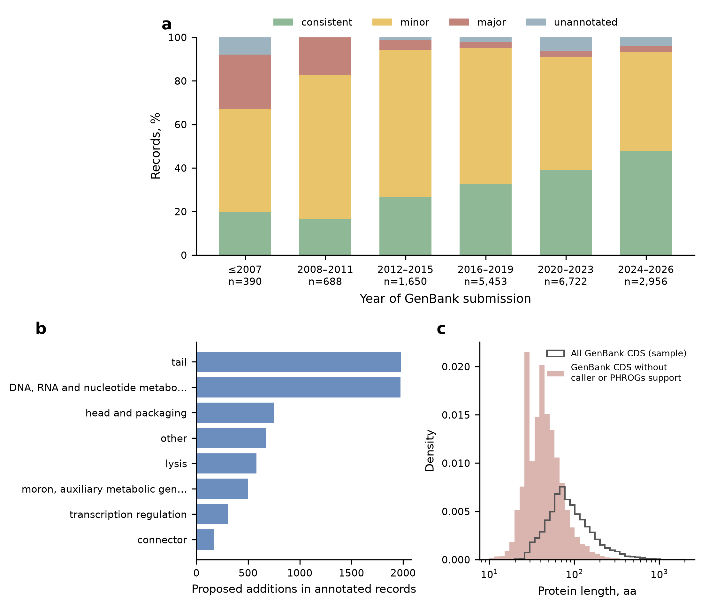

# Phagree

[](https://doi.org/10.5281/zenodo.24523208)

**Gene caller agreement and the quality of bacteriophage genome annotations**

Phagree (*phage* + *agree*) checks and annotates bacteriophage genomes by the agreement of two gene callers, PHANOTATE and Pyrodigal-gv, and by PHROGs homology. It reports GenBank genes without support, genes to add, start codons to correct and hypothetical proteins with a known function, and writes a consensus annotation. For a new genome given as FASTA it produces a draft annotation. Install and run it with two commands (see [Annotate or re-annotate your own genomes](#annotate-or-re-annotate-your-own-genomes)).

This repository also contains the complete study behind the method: a reproducible comparison of the structural and functional annotation of 17,882 complete or high-quality genomes of DNA phages that infect bacteria (INPHARED2 / NCBI GenBank). CDS predicted by PHANOTATE and Pyrodigal-gv are compared with GenBank by exact coordinates and shared stop codons. Proteins are annotated with PHROGs v4 HMMs, and a probability sample is also annotated with Phold. The statistics use cluster-robust GEE, which accounts for relatedness between phages. Two exploratory analyses extend the study: which GenBank records disagree with both callers and how this depends on record age, and a consensus re-annotation of all records.

## Key results

Full cohort: 17,862 genomes in the primary analysis, 2,300,621 stop-loci, 4,490 relatedness blocks.

| Result | Value |
|---|---|
| Agreement (stop-codon Jaccard) | GenBank–Pyrodigal-gv 0.880; GenBank–PHANOTATE 0.798; PHANOTATE–Pyrodigal-gv 0.808 |
| Caller support and function | No specific function in 95.3% of single-caller ORFs vs 64.0% of two-caller ORFs; adjusted OR 0.49 (95% CI 0.43–0.56); robust to PHROGs thresholds and length strata |
| Length and overlaps | Single-caller support in 38.9% of ORFs < 100 aa vs 3.7% of longer ORFs; antisense overlap OR 43.9 |
| Structure-informed annotation (Phold) | Function assigned to 18.2% (14.8–22.3%) of sampled proteins lacking one, mostly ≥ 100 aa |
| ORFs absent from GenBank | 6,399 ORFs in 3,986 fully annotated genomes match characterised PHROGs, mostly DNA metabolism and lysis |
| GenBank "hypothetical" proteins | 65.9% of GenBank CDS; 13.9% of them have a specific PHROGs function |
| Records discordant with both callers | 7.5% of genomes: 716 deposited without any CDS (peak 2020–2023, hybrid assemblies OR 7.3) and 623 annotated but discordant (submitted ≤2007 OR 5.6, 2008–2011 OR 4.2 versus 2020–2023) |
| Consensus re-annotation | 21,353 GenBank CDS without caller or PHROGs support flagged; functional names proposed for 176,126 CDS annotated as hypothetical; 6,983 functionally annotated genes proposed for 3,215 annotated records; 707 records (4.0%) need major revision |



*Figure 4. Share of ORFs without a specific PHROGs function, split by caller support (left: by length class, 95% cluster-bootstrap CI) and the full functional status breakdown (right).*

The full numbers are in [`docs/RESULTS.md`](docs/RESULTS.md) and [`docs/RESULTS_EXPLORATORY.md`](docs/RESULTS_EXPLORATORY.md), and all figures are in [`figures/`](figures/).



*Figure 13. Consensus re-annotation: record classes by year of GenBank submission (a), PHROGs categories of genes proposed for annotated records (b), and length of GenBank CDS without any support (c).*

## Consensus annotation

`results/reannotation/consensus_annotation.gff3.gz` gives a consensus gene set for each of the 17,859 records, and `results/reannotation/gene_proposals.csv.gz` lists, per record, the GenBank CDS flagged for review, the proposed additions, the start corrections and the functional names proposed for hypothetical proteins. The same rules can be applied to genomes outside the cohort (see `docs/REPRODUCE.md`, step 9). `results/reannotation/records_reannotation.csv.gz` gives each record's class (consistent, minor revision, major revision, unannotated). Flagged and proposed genes are review targets, not proven errors: some flagged genes are genuine, for example NinD and NinE of phage lambda.

## Annotate or re-annotate your own genomes

Install with conda or mamba (PHANOTATE, Pyrodigal-gv and pyhmmer are installed in the same environment):

```bash
mamba create -n phagree -c conda-forge -c bioconda phagree
conda activate phagree
phagree setup                      # once: PHROGs library (about 10 min), PHANOTATE check, config
phagree annotate MN510331.1 my_new_phage.fasta records.gbk -o results/my_phages
```

`setup` downloads the official PHROGs v4 alignments (a Zenodo mirror is used if the PHROGs site is unreachable; transient errors are retried), checks their SHA-256, builds the HMMER3 library in parallel and verifies that its content is identical to the library of the study. If a verified library is already present, nothing is downloaded or rebuilt. The library itself is not redistributed. The database folder is `~/.local/share/phagree` by default; choose another with `--db <folder>` or `PHAGREE_DB=<folder>` (pass the same folder to `annotate`). In a checkout of this repository that already has `data/db/phrogs_v4/`, that folder is used.

Until the Bioconda package is published, the same environment is created with:

```bash
mamba create -n phagree -c conda-forge -c bioconda python=3.13 phanotate=1.6.7 pyrodigal-gv=0.3.2 pyhmmer=0.12.3 "python-duckdb<2" pyarrow biopython pandas psutil pip
conda activate phagree
pip install --no-deps git+https://github.com/rarltyD/Phagree@v1.0.0
```

From a checkout of this repository (see Quick start), the same commands are `.venv/bin/phagree setup` and `.venv/bin/phagree annotate ...`.

`annotate` accepts GenBank accessions, GenBank files and FASTA files of new genomes, in any combination. Genomes with ambiguous bases (N or other IUPAC codes) are processed: affected genes are compared by coordinates, searched as X-masked proteins and flagged. Results in `results/my_phages/reannotation/`:

| File | What it tells you |
|---|---|
| `records_reannotation.csv.gz` | One row per genome: consistent, minor revision, major revision or unannotated, with gene counts and ambiguous bases |
| `gene_proposals.csv.gz` | Genes to check (no support), to add (both callers + PHROGs function), to rename (hypothetical with a known function) and start codons to change |
| `consensus_annotation.gff3.gz` | Consensus gene set with PHROGs product names; for a FASTA genome this is a complete draft annotation |
| `sequence_quality.csv.gz` | Ambiguous bases per genome and their positions |

A typical phage genome takes under a minute. Flagged and proposed genes are review targets, not proven errors.

## Repository layout

| Path | Content |
|---|---|
| `src/phagree/` | Pipeline package: GenBank import, gene-caller adapters, CDS matching, storage, validation |
| `scripts/cohort/` | Cohort metadata, host-domain resolution, protocol amendments |
| `scripts/phrogs/` | Building the PHROGs HMMER3 library; cached protein search |
| `scripts/pipeline/` | GenBank download, batch manifests, batch runner, resource guard, checkpoint rebuild, merging of batches, post-processing |
| `scripts/analysis/` | Primary statistics (GEE, cluster bootstrap), robustness, descriptive statistics, figures, Phold |
| `scripts/record_age/` | GenBank record metadata, discordance with both callers by record age |
| `scripts/reannotation/` | Consensus re-annotation rules, summary tables and figure |
| `scripts/reproducibility/` | Cross-machine check with reference calls |
| `tests/` | Automated tests (`pytest`) |
| `configs/` | Prespecified protocol parameters and run configurations |
| `environment/` | Conda environment files with pinned versions |
| `docs/` | Protocol and amendments, reproduction guide, results, references |
| `manifests/` | Validated cohort manifest, accession lists of the nested batches, checksums |
| `results/` | Final statistics, descriptive tables, robustness analyses, Phold results, record age, consensus re-annotation |
| `figures/` | Figures 1–13 (PNG; SVG and PDF where available) |

## Quick start

```bash
git clone https://github.com/rarltyD/Phagree.git && cd Phagree
conda env create -f environment/environment.yml && conda activate phagree
conda create -n phanotate --file environment/phanotate-explicit.txt   # PHANOTATE 1.6.7
python -m venv --system-site-packages .venv && .venv/bin/pip install --no-deps -e .
.venv/bin/python -m pytest -q        # PHANOTATE integration tests need PHAGREE_TEST_CONFIG
```

The complete workflow, from cohort selection to figures, is described in [`docs/REPRODUCE.md`](docs/REPRODUCE.md).

## Data not included

The raw GenBank records (~4 GB), caller outputs and per-locus tables (tens of GB) are not stored here. They can be regenerated from public sources with the accession lists in `manifests/` and the steps in [`docs/REPRODUCE.md`](docs/REPRODUCE.md).

## Methods in brief

The protocol was fixed before analysis (16 October 2026); all later changes are dated amendments with rationale in [`docs/PROTOCOL.md`](docs/PROTOCOL.md). The record-age analysis and the consensus re-annotation were added after the primary analysis and are documented there as exploratory analyses E1 and E2.

- **Tool versions:** PHANOTATE 1.6.7, Pyrodigal-gv 0.3.2 / Pyrodigal 3.7.1, Biopython 1.88, pyhmmer 0.12.3 with PHROGs v4 (rebuilt as HMMER3 profiles), Phold 1.2.6 / Foldseek 10.941cd33.
- **PHROGs E-values:** computed per search block of up to 20,000 proteins in the study; from the next release, for a fixed search space of 20,000 proteins, so that results do not depend on how many genomes are annotated together.
- **Reproducibility check:** 17 genomes recomputed from scratch on a second machine gave 7,247/7,247 identical CDS calls.

## Citation

Kerimov, T.T. Phagree: gene caller agreement and consensus re-annotation of bacteriophage genomes (v1.0.0). Zenodo, 2026. https://doi.org/10.5281/zenodo.24523209

The DOI above is the exact version used in the article; https://doi.org/10.5281/zenodo.24523208 always resolves to the latest release. See also [`CITATION.cff`](CITATION.cff).

## Contact

T.T. Kerimov — kerimov03.t14@gmail.com

## License

The code is released under the MIT License. The underlying data come from public databases (NCBI GenBank, INPHARED2, PHROGs) and remain subject to their own terms.
